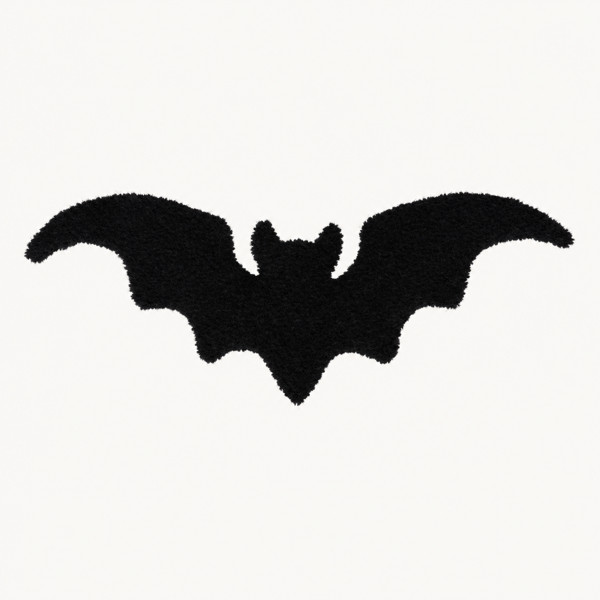
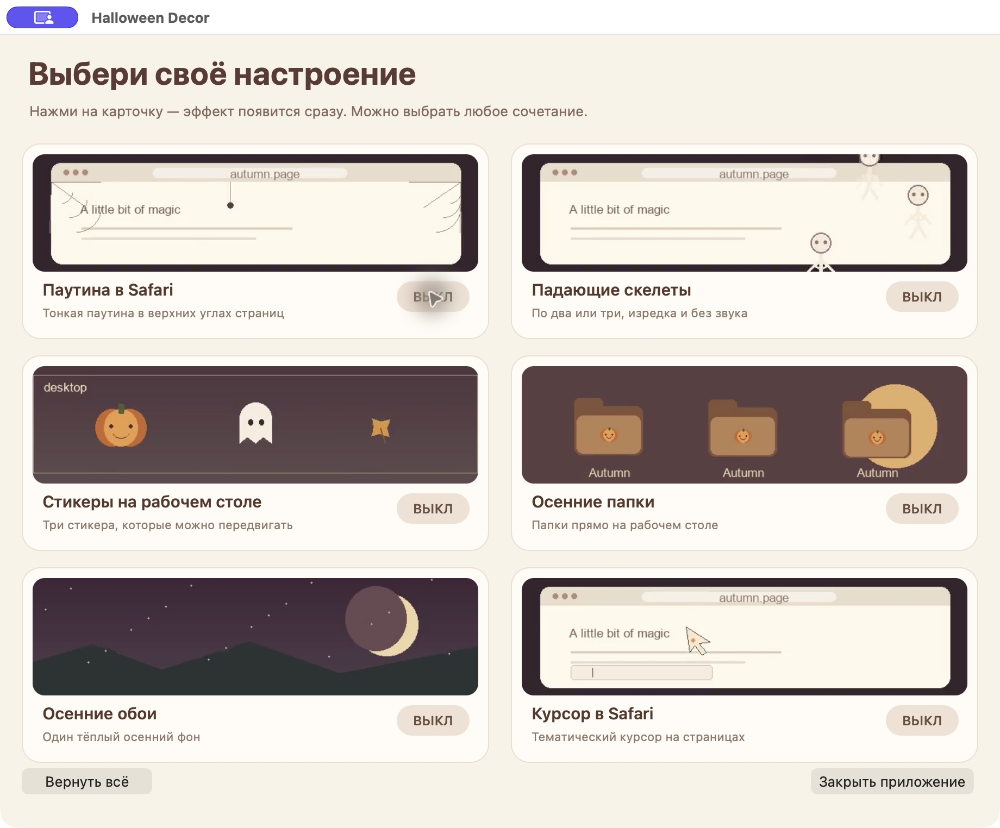
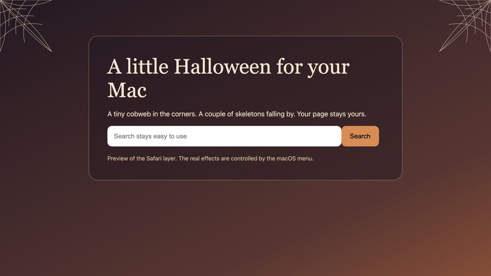
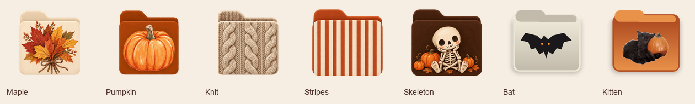

# Halloween Decor







The image above shows the page layer on a local demo page. It is not a screenshot of the extension installed in Safari.

For a live Safari check, run `python3 -m http.server 47902 --bind 127.0.0.1` from the repository root and open `http://127.0.0.1:47902/demo/live.html` in Safari. Unlike `demo/index.html`, this page has no decoration script of its own, so any effects visible there come from the installed extension.

A small, original Halloween decoration kit for macOS and Safari. Opening the Mac app shows one native window with six selectable cards and silent looping video previews: Safari webs, falling skeletons, desktop stickers, autumn icons for folders on the Desktop, a wallpaper, and a Safari page cursor. Click a card or its switch to apply or remove that effect immediately. Any combination is possible. Each Desktop folder gets a randomly selected illustrated icon from seven autumn styles; its selection stays stable until the effect is turned off.



## Requirements

- macOS 13 or later, Safari 17 or later
- Apple Command Line Tools (`swiftc`)

## Build and run the Mac app

```sh
./scripts/build-app.sh
open "build/Halloween Decor.app"
```

The app creates its own wallpaper and icons. It stores backups in `~/Library/Application Support/Halloween Decor/`, including a copy of the previous wallpaper image. It opens its selection window on launch; click the pumpkin in the macOS menu bar to reopen it after closing the window. **Restore Everything** turns off all six effects and restores recorded icon and wallpaper changes. Each desktop effect is also restored when its own card is switched off. The six preview videos are original, silent, and stored inside the app. To regenerate them, run `python3 scripts/generate-previews.py` (requires Pillow and ffmpeg). To regenerate the app icon, run `python3 scripts/generate-app-icon.py` (requires Pillow and macOS `iconutil`).

## Load the Safari extension

Safari → Settings → Advanced → Show features for web developers. Then Safari → Settings → Developer → Allow unsigned extensions → Add Temporary Extension… and choose `safari-extension`. Grant website access when Safari asks. Keep the Mac app running so Safari can read the six toggle states at `127.0.0.1:47831`.

Safari removes temporary extensions after quitting or after 24 hours. The Safari toolbar, address bar, Spotlight, and other apps' cursors are outside the extension's reach. The menu bar app remains installed locally until deleted.

## Install locally

Drag `build/Halloween Decor.app` to Applications. This local build is ad-hoc signed, without a Developer ID or notarization. macOS may require System Settings → Privacy & Security → Open Anyway on first launch. A distributable Safari extension needs an Xcode containing app and signing; this repository currently provides a temporary development extension.

## Privacy and safety

All effects and settings stay on the Mac. The bridge listens only on `127.0.0.1`. No analytics or remote requests. The app backs up icons for Desktop folders before changing them and records the current wallpaper for each display. **Restore Everything** restores recorded changes and turns all effects off. Do not delete the app's Application Support data while folder icons or wallpaper are active.

## Art

Vector art and drawings in this project are original and use a warm autumn palette. The Halloween Decor app icon uses a soft black bat silhouette inspired by the supplied reference. No Peanuts characters or third-party artwork is copied.

## Status

This is a local development build. See `docs/IMPLEMENTATION.md` for architecture and current limitations.
