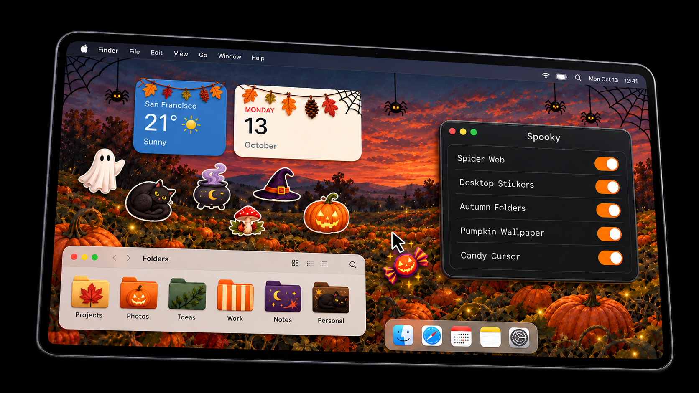
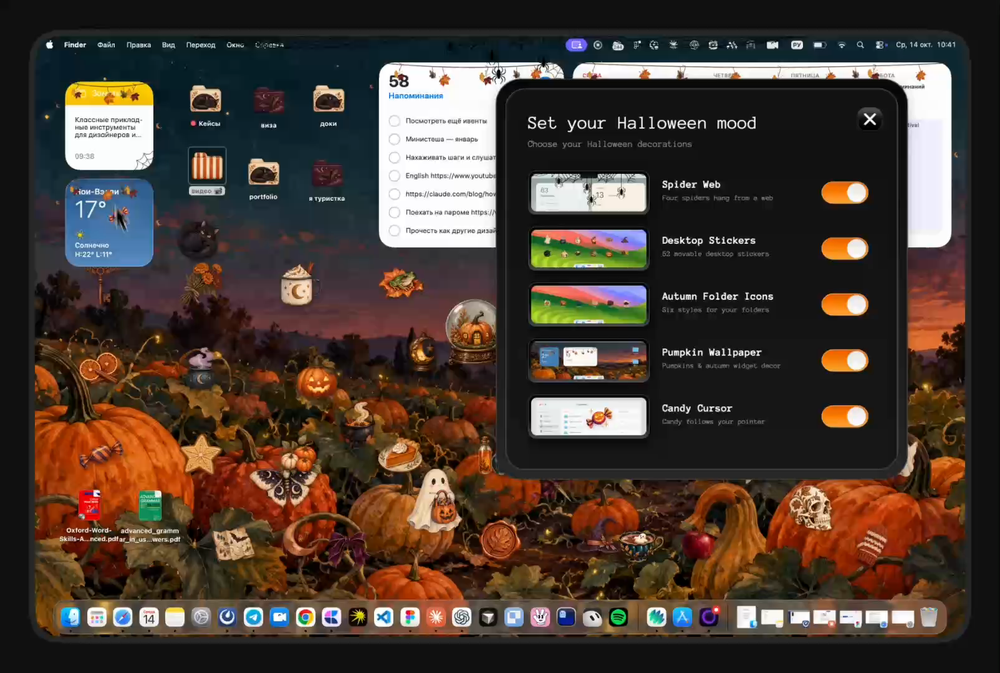

# Spooky



*Stylized 3D preview. Watch the real app in the video below.*

**Spooky adds a little Halloween to macOS:** a screen-top spider web, movable desktop stickers, illustrated folder icons, a pumpkin wallpaper with widget decorations, and a candy pointer. Turn each effect on or off in one small Mac app.

> **Release status:** This repository publishes source code, MIT-licensed artwork, and previews. The Mac app built locally is a development build; the Safari extension currently uses Safari's temporary extension workflow. Uploaded binaries were removed from all 11 older Halloween Decor releases because they were ad-hoc signed and not notarized. Their pages and source tags remain for historical reference; GitHub's automatic source archives are not a Spooky installer. A public, one-click Spooky download requires a signed and notarized Mac build and a packaged Safari extension if that extension is advertised. See [Publishing](docs/PUBLISHING.md).

## See it in action

[](docs/media/spooky-demo.mp4)

**Spider Web:** [Image](docs/media/webs.png) · [Animation](macos/Previews/webs.mp4)

## Features

- **Spider Web:** four spiders hang from a web pinned to the top edge of each display, above the menu bar.
- **Desktop Stickers:** movable Halloween cutouts. Their positions are saved locally.
- **Autumn Folder Icons:** six styles are assigned to Desktop folders and remain stable until switched off.
- **Pumpkin Wallpaper:** a pumpkin field with leaves, pinecones, stars, and webs around desktop widgets.
- **Candy Cursor:** a pixel-art candy follows the pointer. macOS can restore its native arrow when focus changes, so pointer appearance may vary by app and system version.

## Build locally

Requirements: macOS 13 or later, Apple Command Line Tools with `swiftc`. To regenerate the preview media, install Python 3 with Pillow and FFmpeg.

```sh
./scripts/build-app.sh
open build/Spooky.app
```

This script creates an **ad-hoc signed development app**, not a public release. It does not install a Safari extension or make the app notarized. A separate [release packaging script](scripts/package-release.sh) is ready for a Developer ID identity and notarytool profile. Review [the release checklist](docs/PUBLISHING.md) before distributing a binary.

## Try the Safari extension during development

In Safari, enable developer features and unsigned extensions, then add the `safari-extension` directory as a temporary extension. Grant website access if you want the candy cursor on pages. Keep Spooky running: the extension reads the cursor switch from `127.0.0.1:47831`.

The extension currently requests access to all HTTP and HTTPS sites, including frames, to draw the cursor consistently. It is **not bundled in the Mac app** and Safari may remove a temporary extension after a restart. See [Apple's distribution requirements](https://developer.apple.com/documentation/safariservices/distributing-your-safari-web-extension) for a permanent extension.

For a local visual check, run `python3 -m http.server 47902 --bind 127.0.0.1` from this directory and open `http://127.0.0.1:47902/demo/live.html` in Safari.

## Changes to your Mac

Spooky writes only local settings and backups. It can change the Desktop wallpaper and folder icons when you turn those effects on. Switching each effect off restores the recorded previous state. Keep `~/Library/Application Support/Halloween Decor/` until your original wallpaper and folder icons have been restored; it contains their backups. The app has no analytics or remote service calls. See [Privacy and permissions](docs/PRIVACY.md).

## Project details

- [How it works and known limitations](docs/IMPLEMENTATION.md)
- [How to review and publish a release](docs/PUBLISHING.md)
- [Current release audit](docs/RELEASE_AUDIT.md)
- [GitHub description and release copy](docs/GITHUB_COPY.md)
- [Artwork and font provenance](docs/ASSETS.md)
- [Release notes](docs/RELEASE_NOTES.md)
- [Security reporting](SECURITY.md)

Code and original project artwork, including the user-authorized candy cursor, are available under the [MIT License](LICENSE). Anonymous Pro remains under its bundled [SIL Open Font License](macos/Fonts/OFL.txt). Artwork provenance is documented in [ASSETS.md](docs/ASSETS.md).
